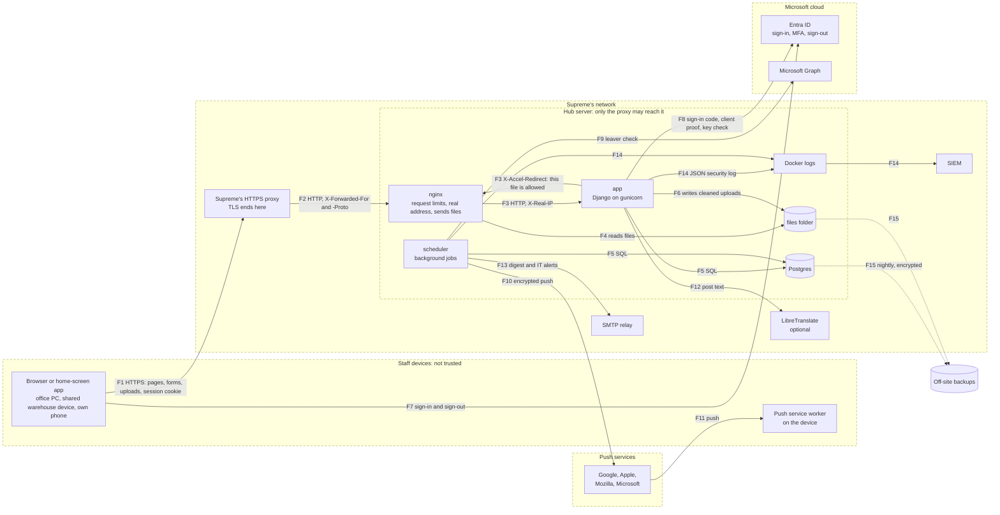

# Threat model: One Supreme staff hub

| | |
|---|---|
| What | Supreme PLC's private staff hub: feed, news, chat, groups, events, people, files, knowledge base, journeys, jobs, alerts, search, moderation |
| Version | `main` at 217d0bb (20 Nov 2026) plus the fixes on `team/threatmodel` |
| Written | 20 Nov 2026, by the "Threat model and security baseline" team |
| Method | The four questions (what are we building, what can go wrong, what do we do about it, did we do a good job). STRIDE on every data flow and every feature. Risks scored likelihood x impact, 1 to 5 each. |
| Baseline | OWASP ASVS 4.0.3 Level 2, assessed in `docs/security/ASVS-L2.md` |
| Next review | Before the pilot (11 Jan 2027), before full rollout (19 Feb 2027), then every 6 months, and whenever section 9 says so |

"Proof" in the tables below is the code that does the job and the test that shows it. A test name alone is in the
file named next to it. Work another team has finished on its own branch, but which isn't merged into `main` yet, is
marked with that branch, for example "(team/hardening)". "(this branch)" means fixed on `team/threatmodel`.
"Supreme IT" means Supreme's IT department does it outside the code.

## 1. What we are building

About 500 Supreme staff, in offices and a warehouse, sign in with their Microsoft work account (Entra ID) and use
the hub in a browser or as a home-screen app. Office staff mostly use company PCs. Warehouse staff often share a
device, or use their own phone.

The hub is one Django 5.2 app with server-made pages. It runs in Docker Compose on Supreme's own server: nginx in
front, the app on gunicorn, a scheduler for background jobs, Postgres, and a folder of uploaded files. Supreme's
HTTPS proxy sits in front of nginx. The hub talks to Entra ID and Microsoft Graph (sign-in and the leaver check),
the push services of Google, Apple, Mozilla and Microsoft, Supreme's SMTP relay, and optionally a LibreTranslate
server inside Supreme's network.

Who can do what:

| Role | How someone gets it | Extra rights |
|---|---|---|
| Staff | A Supreme Entra account with a company email address | Everything for staff: posts, chat, groups, events, files they may see |
| Group admin | Made admin of a group by another group admin | Edit that group, invite, approve, remove members, pin posts in it, manage its files |
| News publisher (Communications) | Django group with "Can publish news" | Write news for chosen audiences; see who confirmed must-read news |
| Insights viewer | "Can view usage figures" | Totals only, no individual tracking |
| Editor | Add, change, delete on documents, articles, journeys, vacancies | Company files, knowledge base, journeys, jobs |
| Organisation admin | Change on groups and units | Build the organisation and place people in it |
| Moderator | View, change, delete on posts, comments, reports; view log entries | Opens hidden and deleted posts, hides content, closes reports, opens chat pictures of reported people |
| Superuser | Ticked in the admin | Everything, including making others superuser |
| Break-glass admin | One password account, made at install; works only while `ALLOW_PASSWORD_LOGIN=1` | Superuser, for when single sign-on is down |
| IT operator | A shell on the server | The containers, the database, the files, `.env` and the logs |

Out of scope here, and owned by Supreme IT: the staff devices, Supreme's network and proxy, the Entra tenant and its
Conditional Access policies, the SMTP relay, the SIEM and the server's operating system. Section 4 shows where they
meet the hub.

## 2. Assets: what we protect

| Asset | Examples | Where it lives | Class | How it is protected |
|---|---|---|---|---|
| Staff accounts | Email, name, Microsoft's permanent user ID (`sso_id`), roles and permissions | Postgres `hub_user`, Django groups | Confidential | Single sign-on only, company domains only, account tied to the permanent ID (`hub/auth.py`) |
| Profiles | Job title, department, work phone, bio, pronouns, languages, photo, cover, opt-in birthday (no year), start date, last active | Postgres, files folder | Internal (all staff see them) | Sign-in on every page; email and "active" dot can be hidden; birthday opt-in |
| Private posts and comments | Posts in private groups and units, drafts, scheduled posts, hidden and deleted posts | Postgres, files folder | Confidential | Per-post checks (`Post.objects.viewable_by`, `hub/views.py can_open_post`), file guards |
| Chats | One-to-one and group messages and pictures | Postgres `chat_*`, files folder `chat/` | Highly confidential | Members only; later joiners see nothing older (`chat/views.py member_or_404`, `chat/hooks.py can_open_picture`) |
| Files | Company documents, group files, photos and videos | Files folder (`media` volume) | Confidential | Served only after a guard says yes (`hub/views.py media`, `plugins.MEDIA_GUARDS`); stored under random names |
| Moderation and HR evidence | Reports, hidden and deleted items kept 30 days, the admin log | Postgres `hub_report`, `django_admin_log` | Highly confidential | Moderators only; deleted items kept while a report is open; admin log read-only (`hub/admin.py AuditLogAdmin`) |
| Who did what | News read and confirmed, RSVPs, journey progress, interest in a vacancy | Postgres | Confidential (job interest is sensitive: it says someone wants to move) | Interest seen only by the recruiter and editors (`jobs/views.py can_see_interested`); read lists only for must-read news |
| Security log | Sign-ins, refusals, limits hit, exports, deletions, with email and IP address | Docker logs, then Supreme's SIEM | Confidential | JSON lines (`hub/security.py audit`); secrets blanked (team/hardening); readable by IT only |
| Secrets | `SECRET_KEY`, database passwords, Entra secret or certificate key, VAPID private key, SMTP and translation passwords | `.env` and `secrets/` on the server | Secret | Never in the code or the image (`.gitignore`, `.dockerignore`); `.env` readable by one account; rotation in the runbook (team/handover) |
| Sessions | Session cookie, form token | Browser, Postgres `django_session` | Secret | HttpOnly, Secure, SameSite=Lax; `__Host-` name in production (this branch); 15-minute re-check with Entra |
| Push sign-ups | Push service address and keys per device | Postgres `hub_pushsubscription` | Confidential | Only known push services accepted (`hub/account.py push_subscribe`); messages encrypted end to end (`hub/push.py`) |
| Backups | Database dump and files | Server, then an off-site share | Same as everything above | Encrypted before they leave the server (team/reliability) |
| The hub being up | Shift news and messages for the warehouse | The whole server | Business | Activity limits, request limits, disk guard, `/healthz` and backups (team/reliability) |

## 3. Actors: who might attack, and what they want

| # | Actor | Starts with | Wants to | Main defences |
|---|---|---|---|---|
| A1 | Outsider: bots, criminals, a competitor | Nothing; can reach the sign-in page if the proxy is open to the internet | Get in with stolen or guessed passwords, phish staff, read data, take the hub down | Every page needs sign-in; only Supreme's tenant and company email domains get in; MFA in Entra (Supreme IT); password sign-in off; nginx request limits |
| A2 | Curious colleague, including the next person at a shared warehouse device | A normal staff account, or a device someone left signed in | Read private groups, other people's chats, drafts, hidden emails, who is interested in which job; carry on as the last person | Server-side checks on every object; "not found" for things you may not see; no-store pages and Microsoft sign-out on Sign out (this branch); 12-hour sessions (team/hardening) |
| A3 | Hostile colleague | A normal staff account | Harass, spam, post scripts or bad links, upload malware, destroy evidence, file false reports, flood mentions and invitations | Escaped text, strict CSP, uploads re-made or type-checked, per-person limits, deletions kept 30 days, reports and the admin log |
| A4 | Leaver | An old session; maybe a copy of files | Keep reading, take data on the way out | Entra disables them; the hub re-checks every 15 minutes; the nightly leaver check switches them off; an admin can switch them off at once; data export limited (team/hardening) |
| A5 | Compromised admin or moderator, or a rogue one | Moderator or superuser rights, or their account | Read every private post, open chat pictures, make others superuser, cover tracks | Admin only through single sign-on with MFA; admin pages only from the office or VPN (team/hardening); every moderator action in a read-only log and the SIEM; few superusers, checked quarterly (team/handover) |
| A6 | Compromised supplier | A Python library, a Docker image, Microsoft, a push service, the translation server, the SMTP relay, or the hub's own developers | Run code in the hub, read what passes through them | Pinned libraries, dependency audit, Dependabot, CodeQL and secret scan in CI (team/foundations); no scripts from other sites (CSP); push encrypted end to end; translation and mail kept inside Supreme |
| A7 | Someone with the server or its backups | Shell access, a stolen disk, a copy of a backup | Read everything at once | Supreme IT: encrypted disks, few admins; encrypted backups (team/reliability); the app's database account can't change tables (team/hardening) |

## 4. Trust boundaries and data flows

Dashed boxes are trust boundaries. Everything crossing one is checked on the side that receives it.

Not drawn: moderators and admins use F1 to F3 like everyone else, but `/admin/` only opens from the office and VPN
ranges (F16, team/hardening). IT operators reach the server over SSH and run `docker compose` commands (F17).

| Flow | What crosses | Boundary | Protection |
|---|---|---|---|
| F1 | Every page, form, upload and the session cookie | Device to Supreme | TLS at Supreme's proxy (Supreme IT); HTTPS redirect and HSTS on by default (team/hardening) |
| F2 | The same, plus the visitor's address and scheme | Supreme's network to the server | Firewall: only the proxy reaches port 8080 (Supreme IT); nginx believes `X-Forwarded-For` only from `TRUSTED_PROXY` (`deploy/nginx.conf`); `X-Forwarded-Proto` likewise (team/hardening) |
| F3 | Requests with `X-Real-IP`; file hand-offs | nginx to app, inside Docker | Not published outside Docker (`docker-compose.yml`: only `web` has a port); the app reads the address only from `X-Real-IP`, which nginx overwrites (`hub/security.py client_ip`) |
| F4 | Uploaded files | nginx to files folder | Read-only mount; `/protected-media/` is `internal`, so only an app hand-off reaches it |
| F5 | All data | app and scheduler to Postgres | Password sign-in; database not published; the app's account can only read and write rows (team/hardening) |
| F6 | Cleaned uploads | app to files folder | Checked by content, photos re-made, videos copied without metadata, random names (`hub/media.py`, `library/files.py`) |
| F7 | Sign-in and sign-out pages | Device to Microsoft | Single tenant, MFA (Supreme IT, team/handover ENTRA-SETUP.md); Sign out also signs the browser out of Microsoft (this branch) |
| F8 | The sign-in code, the hub's proof of identity, Microsoft's signing keys | Hub to Microsoft | HTTPS with certificate checks; PKCE; RS256 ID tokens checked against Microsoft's keys (`config/settings.py`); a certificate instead of a secret (team/handover) |
| F9 | Every enabled account's ID and email | Hub to Microsoft | HTTPS; application permission `User.Read.All` only; refuses to switch off more than a fifth (`hub/management/commands/sync_directory.py`) |
| F10, F11 | Alert text (or just "something new"), encrypted for one device | Hub to the internet | RFC 8291 encryption, VAPID signature, only known push hosts, no redirects followed (`hub/push.py`, team/redteam) |
| F12 | A post or comment's text | Hub to Supreme's translation server | Only `TRANSLATE_URL`, set by IT; off unless set; the answer is escaped (`hub/views.py translate`) |
| F13 | Alert lines and links; disk, backup and leaver alerts | Hub to Supreme's mail | Supreme's relay, TLS when `EMAIL_USE_TLS=1`; no post bodies, only alert lines; crash reports never emailed (`config/settings.py LOGGING`) |
| F14 | Security events with email and address | Hub to SIEM | JSON lines; secrets blanked (team/hardening); collected by Supreme IT |
| F15 | Everything | Server to the off-site share | Encrypted before it leaves, restore tested (team/reliability) |

## 5. STRIDE on each data flow

S spoofing, T tampering, R repudiation, I information disclosure, D denial of service, E elevation of privilege.

| Flow | | Threat | What stops it | Proof |
|---|---|---|---|---|
| F1 | S | Someone signs in as a colleague with a stolen or guessed password | Microsoft does the sign-in, with MFA (Supreme IT); only Supreme's tenant and company domains; password sign-in off | `test_sso_only_lets_in_company_addresses_logs_refusals_and_syncs_names`, `test_password_sign_in_can_be_switched_off` (hub/tests.py) |
| F1 | S | The next person at a shared device carries on as the last one | Sign out ends the hub session and the browser's Microsoft session; pages are never kept by the browser | `test_3_3_1_signing_out_also_signs_the_browser_out_of_microsoft`, `test_8_2_1_signed_in_pages_are_never_kept_by_the_browser_and_14_4_2_json_downloads` (hub/tests_asvs.py) |
| F1 | T | Another site makes a colleague's browser post or delete | Form token on every POST; every change is a POST | `test_writes_must_be_posts` (chat/tests.py); `test_every_post_needs_a_csrf_token`, `test_every_change_refuses_a_plain_link` (team/redteam) |
| F1 | I | Session cookie read or planted by another site under the company's domain, or sent over plain HTTP | HttpOnly, Secure, SameSite=Lax; `__Host-` name in production | `test_3_4_4_production_session_cookie_is_host_only_and_single_sign_on_signs_out_of_microsoft` (hub/tests_asvs.py) |
| F1 | I | The hub shown inside another site to trick clicks | `X-Frame-Options: DENY`, `frame-ancestors 'none'` | `test_security_headers_block_foreign_scripts_and_framing` (hub/tests.py) |
| F1 | D | A bot or hijacked account floods pages or uploads | nginx: 50 requests a second per address, 10 password tries a minute; per-person limits in the app | `deploy/nginx.conf`; `test_activity_limits_stop_floods` (hub/tests.py) |
| F2 | S | Someone inside Supreme's network fakes their address to dodge limits or blur the log | nginx believes `X-Forwarded-For` only from the proxy; firewall (Supreme IT) | `deploy/nginx.conf set_real_ip_from` |
| F2 | T | A request claims it came over HTTPS when it didn't | nginx only passes on `https` when the proxy says so | team/hardening `deploy/nginx.conf` (`$from_proxy`) |
| F3 | E | A request reaches gunicorn directly, skipping nginx's limits and file rules | The app container has no published port | `docker-compose.yml` |
| F4 | I | Someone fetches an uploaded file without permission, or guesses a name | Files only after the app's guard; random names; `internal` location | `test_photos_of_hidden_or_deleted_posts_are_blocked_except_for_moderators`, `test_media_is_served_only_inside_the_media_folder` (hub/tests.py) |
| F5 | E | A flaw in the app is used to change or drop tables | The app's database account can only read and write rows; no raw SQL anywhere | team/hardening `deploy/postgres/10-roles.sh` |
| F5 | I | SQL injection | Django's ORM for every query | No `raw(`, `extra(` or `cursor` in app code; team/redteam sweeps with SQL fragments |
| F6 | T | A file that is really a program or web page is stored and shared | Content checks, re-made photos, video copy, random names | `test_files_that_are_not_photos_or_videos_are_rejected`, `test_videos_lose_their_location_and_fakes_are_rejected` (hub/tests.py); `test_disguised_wrong_and_oversized_files_are_refused` (library/tests.py) |
| F6 | D | Uploads fill the disk and stop the database | Size limits; uploads pause at 95% full and IT is emailed | `test_uploads_pause_and_admins_are_emailed_when_the_disk_fills` (hub/tests.py) |
| F7 | S | A guest in Supreme's directory, or someone from another organisation, signs in | Own tenant only, shared Microsoft endpoints refused, company domains only | `config/settings.py` (refuses `common` and `organizations`); `test_sso_only_lets_in_company_addresses_logs_refusals_and_syncs_names` |
| F7 | S | A re-created directory account takes over an old one by email | Accounts tied to the permanent ID; an admin must unlink | `test_sso_keeps_one_account_when_someone_changes_their_email`, `test_a_recreated_directory_account_is_refused_until_an_admin_unlinks_the_old_one` (hub/tests.py) |
| F8 | S | A stolen client secret lets someone act as the hub | A certificate whose key never leaves the server | team/handover `hub/auth.py client_credentials`, `test_sign_in_sends_the_proof_instead_of_a_secret` |
| F8 | T | A forged ID token | RS256 signature checked against Microsoft's keys; PKCE | `config/settings.py` (`OIDC_RP_SIGN_ALGO`, `OIDC_USE_PKCE`) |
| F9 | D | A wrong answer from Microsoft locks everyone out | Refuses to switch off more than a fifth; emails IT on any failure | `test_directory_sync_refuses_to_lock_out_most_of_the_company_and_tells_it`, `test_directory_sync_failure_emails_the_admins` (hub/tests.py) |
| F10 | E | A colleague registers a "push address" that makes the server call an internal system | Known push hosts only, host name only, no redirects | `test_push_only_accepts_known_push_services` (hub/tests_features.py); `test_push_endpoints_that_two_url_readers_see_differently_are_refused` (team/redteam) |
| F10 | I | Google or Apple read alert text | Encrypted for the device; people can show only "something new" | `hub/push.py send_to`; `test_push_follows_each_persons_settings_and_drops_dead_devices` (hub/tests_features.py) |
| F11 | T | A forged push opens a link off the hub | Push messages are encrypted for the device and signed by the hub, and carry only a hub address | `hub/push.py send_pending` (`url` is a hub path) |
| F12 | I | Staff posts sent outside Supreme | Translation only to the server IT sets; off by default | `test_translation_is_off_unless_a_server_is_set` (hub/tests_features.py) |
| F12 | T | The translation server answers with a script | The answer is escaped before it is shown | `test_translation_is_escaped_and_uses_the_readers_language` (hub/tests_features.py) |
| F13 | I | A crash email carries a colleague's post to many inboxes | Django's crash emails are off; errors go to the log | `test_crashes_are_logged_not_emailed` (hub/tests_features.py) |
| F14 | R | Someone denies what they did, or their actions leave no trace | Sign-ins, refusals, deletions, moderation, exports, limits hit and every 403 logged with who, where and when | `test_sign_in_events_are_logged_as_json` (hub/tests.py); `test_7_2_2_refused_requests_are_logged_with_who_and_where` (hub/tests_asvs.py) |
| F14 | I | Passwords, sign-in codes or session ids land in the logs | Blanked in every line; nginx log without query strings | team/hardening `test_secrets_are_blanked_out_of_every_log_line` |
| F15 | I | A copied backup exposes everything | Encrypted with a key kept off the backup share | team/reliability `test_a_backup_is_encrypted_read_back_and_copied_off_site` |
| F16 | E | A stolen admin session is used from anywhere | `/admin/` only from office and VPN ranges, checked by nginx and the app | team/hardening `test_admin_opens_only_from_the_office_and_vpn` |
| F17 | E | A careless or hostile IT operator | Few server admins, quarterly access review, `.env` readable by one account | team/handover RUNBOOK.md "Quarterly access review" (Supreme IT) |

## 6. STRIDE by feature

| Feature | | Threat | What stops it | Proof |
|---|---|---|---|---|
| Sign-in | S | Password spraying against the break-glass account | Off by default; nginx 10 tries a minute per address; 10 per name per 15 minutes (team/hardening); 12-character minimum (this branch) | `test_password_guessing_is_stopped_per_sign_in_name` (team/hardening); `test_2_1_1_passwords_need_at_least_12_characters` |
| Sign-in | R | A sign-in can't be traced | `sign_in`, `sign_out`, `sign_in_failed`, `sign_in_rejected` events | `test_sign_in_events_are_logged_as_json` |
| Sign-in | E | House rules skipped | Middleware sends everyone to the house rules until accepted | `test_newcomers_accept_the_house_rules_first_and_again_when_they_change` |
| Feed and posts | I | Posts of a private group or unit seen by outsiders, in the feed, search or a direct link | `Post.objects.viewable_by` and `in_feed_of`; search uses the same rules | `test_group_posts_only_reach_members_feeds`, `test_search_never_shows_posts_from_groups_you_cannot_see` |
| Feed and posts | T | Editing or deleting someone else's post | Author or moderator only | `test_people_cannot_delete_other_peoples_posts_and_moderator_deletes_are_logged` |
| Feed and posts | E | Script in a post, comment, name or poll answer | Text escaped before formatting; links http(s) only; CSP `script-src 'self'` | `hub/richtext.py`; `test_security_headers_block_foreign_scripts_and_framing`; `test_typed_html_never_reaches_a_page_as_html` (team/redteam) |
| Feed and posts | D | One account floods the feed | 20 posts and 60 comments an hour | `test_activity_limits_stop_floods` |
| Polls | T | Voting twice | One vote per person in the database | `test_polls_take_one_vote_per_person_and_close` |
| Pinned and announcements | E | Pinning or alerting everyone without the right | Moderators, and group admins in their group, only | `test_only_moderators_and_group_admins_pin`, `test_only_staff_can_pin_announcements_and_everyone_is_told` |
| News | I | Drafts, scheduled or audience-only news seen early or by others | Live and audience checks | `test_draft_and_scheduled_news_stay_hidden_until_live`, `test_news_reaches_only_its_audience_and_tracks_unread` |
| News | I | A publisher learns who is in a private group from the readers list | The news must be one they may open | `test_must_read_readers_list_needs_the_news_to_be_visible` (team/redteam) |
| Chat | I | Reading a chat you're not in, or messages from before you joined | Membership checked on every chat address and picture; "not found" otherwise | `test_only_members_can_read_poll_send_or_open_pictures`, `test_people_added_later_see_only_what_was_said_after_they_joined` (chat/tests.py) |
| Chat | T | Deleting someone else's message | Senders delete their own only | `test_people_delete_only_their_own_messages_and_the_picture_is_blocked` |
| Chat | R | A harasser deletes messages before HR sees them | Messages of someone under an open report are kept | `chat/hooks.py purge`; `test_a_reported_picture_is_kept_and_moderators_can_open_it` |
| Chat | D | Message floods | 300 messages an hour, 10 group chats a day | `test_rate_limit` (chat/tests.py) |
| Groups and organisation | E | Joining a private group without an invitation, or acting as its admin | Invitation or approved request; admin checks | `test_private_groups_need_an_invitation_or_an_approved_request`; `test_group_admin_actions_need_a_group_admin` (team/redteam) |
| Groups and organisation | T | Staff move themselves into units to read their posts | Units are set by organisation admins only | `test_units_are_set_by_admins_not_joined_or_left` |
| Events | I | A group's events seen by outsiders | Only company-wide events and events of your groups | `hub/views.py visible_events`; `test_group_event_notifies_members_and_exports_to_calendar` |
| Events | T | A calendar file given extra lines (a hidden link) | Every kind of line break escaped | `test_calendar_files_cannot_be_given_extra_lines` (team/redteam) |
| People | I | A hidden email address found by searching | Only shown addresses are searched | `test_hidden_email_addresses_cannot_be_found_by_searching` (team/redteam) |
| People | I | Birthdays and "active now" expose more than people want | Opt-in, no year kept; the dot can be switched off | `test_birthdays_are_opt_in_and_keep_no_year` |
| Files and library | I | A private group's files downloaded by others | Group files for members only; company files need the editor permission to change | `test_private_group_files_download_for_members_only_under_their_original_name`, `test_company_files_need_the_permission_and_group_files_a_group_admin` (library/tests.py) |
| Files and library | T | A disguised program or web page shared as a document | Content must match the ending; non-media files always download | `test_disguised_wrong_and_oversized_files_are_refused` (library/tests.py); `hub/views.py media` |
| Knowledge base | T | Staff change articles | Editors only | `test_only_editors_can_change_the_knowledge_base` |
| Journeys | T | Ticking steps out of order, or seeing someone else's journey | Steps unlock in order; journeys only for the people given them | `test_steps_unlock_in_order_but_editors_can_open_any`, `test_people_without_the_journey_get_404` |
| Jobs | I | Colleagues or a manager see who is interested in a vacancy | Only the recruiter, the creator and editors | `test_who_is_interested_is_private` (jobs/tests.py) |
| Alerts and push | I | Alerts or push reveal content to someone outside the post | Alerts follow the audience; push can hide the text | `test_push_follows_each_persons_settings_and_drops_dead_devices` |
| Search | D | A pasted page of words makes a huge query | First 10 words; searches limited per person (team/hardening) | `test_a_search_with_hundreds_of_words_is_cut_short` (team/redteam) |
| Insights | I | Usage figures used to watch individuals | Totals only, behind a permission | `test_usage_figures_need_permission` |
| Moderation | R | A moderator hides or restores content and denies it | Every action in the read-only admin log and the security log | `test_reports_reach_moderators_who_can_hide_and_close_them`, `test_moderators_can_restore_a_deleted_post` |
| Moderation | T | A moderator changes who a report is about | Report fields read-only in the admin | `test_moderators_cannot_change_who_a_report_is_about` |
| Data export | I | Someone else's data in my export | The export only reads the signed-in person's rows | `test_people_can_download_their_data` |
| Data export | D | Repeated exports of large files | 5 a day per person (team/hardening) | `test_search_translation_and_data_export_are_limited_per_person` (team/hardening) |
| Retention | I | Old content and leavers kept forever | Daily clean-up by the agreed periods | `test_retention_removes_old_alerts_and_counts_from_the_day_someone_left`, `test_purge_keeps_alerts_at_0_keeps_reported_leavers_and_removes_covers` |
| Leavers | E | A leaver keeps using the hub | 15-minute re-check; nightly leaver check; admin switch-off takes effect on the next request | `test_directory_sync_switches_off_leavers_only`; `hub/auth.py get_user` |
| Demo server | I | Real staff data on the public demo, or shared demo passwords | Made-up data only; seeded colleagues have no password there | `test_public_demo_only_lets_the_new_logins_in` (hub/tests_demo.py) |

## 7. Abuse cases

Each "As staff I can" has the attack someone will try next to it.

| As staff I can... | As an attacker I try to... | What happens | Proof |
|---|---|---|---|
| sign in with my work account | sign in with a guest or partner account from Supreme's directory | Refused and logged (`sign_in_rejected`) | `test_sso_only_lets_in_company_addresses_logs_refusals_and_syncs_names` |
| sign out on a shared warehouse device | press Back, or press "Sign in" again, to carry on as the last person | Back shows nothing kept; Microsoft asks who is signing in | `test_8_2_1_...`, `test_3_3_1_signing_out_also_signs_the_browser_out_of_microsoft` |
| post to my team | post into a private group I'm not in by changing the group in the form | Refused | `test_only_members_can_post_into_a_group` |
| open a post someone shares with me | open a draft, a scheduled post or a private group's post by changing the number in the address | "Not found" | `test_someone_elses_draft_scheduled_or_private_post_is_not_found_anywhere` (team/redteam) |
| see photos in a post | download the photo of a hidden or deleted post by its address | "Not found", unless a moderator | `test_photos_of_hidden_or_deleted_posts_are_blocked_except_for_moderators` |
| format my post with bold and links | post `<script>` or a `javascript:` link | Shown as text; only http(s) links | `test_typed_html_never_reaches_a_page_as_html` (team/redteam); `test_messages_are_escaped_and_formatted` (chat/tests.py) |
| add photos and videos | upload a web page or program named `.jpg`, a picture that unpacks to gigabytes, or a video with my home's GPS position | Refused, or cleaned of location | `test_files_that_are_not_photos_or_videos_are_rejected`, `test_a_photo_with_too_many_pixels_is_refused_before_it_is_unpacked`, `test_iphone_videos_lose_their_location` |
| share a document in my group | upload a `.pdf` that is really an HTML page, then send colleagues the link | Refused; and any non-media file downloads instead of opening | `test_disguised_wrong_and_oversized_files_are_refused` |
| chat with a colleague | read a chat I'm not in, or older messages after being re-added | "Not found" | `test_only_members_can_read_poll_send_or_open_pictures`, `test_a_member_cannot_reach_messages_from_before_they_joined` (team/redteam) |
| delete my own post | delete a colleague's post, or delete my harassing posts before HR looks | Refused; my own deleted posts are kept 30 days, and longer while reported | `test_people_cannot_delete_other_peoples_posts_and_moderator_deletes_are_logged`, `test_deleted_posts_are_kept_30_days_unless_under_report_then_removed_with_files` |
| report a post or person | flood the moderators with false reports | 10 reports an hour; each is logged | `hub/security.py LIMITS`; `test_reports_reach_moderators_who_can_hide_and_close_them` |
| vote in a poll | vote twice | One vote per person, enforced by the database | `test_polls_take_one_vote_per_person_and_close` |
| tick off my onboarding steps | tick the last step first, or tick steps of someone else's journey | Refused or "not found" | `test_steps_unlock_in_order_but_editors_can_open_any`, `test_people_without_the_journey_get_404` |
| say I'm interested in a vacancy | find out which colleagues applied | Only the recruiter and editors see the list | `test_who_is_interested_is_private` |
| look people up | find someone's hidden email by searching "a@", "b@"... | Hidden addresses aren't searched | `test_hidden_email_addresses_cannot_be_found_by_searching` (team/redteam) |
| switch on push alerts | register a "push address" pointing at an internal server, so the hub attacks it | Refused: known push services only | `test_push_only_accepts_known_push_services`; `test_13_2_5_push_sign_up_only_takes_json` |
| use "See translation" | have my post's text sent outside Supreme | Only to Supreme's own server, and only if IT set one | `test_translation_is_off_unless_a_server_is_set` |
| download my data | download a colleague's data, or download mine over and over to load the server | Only my rows; 5 a day (team/hardening) | `test_people_can_download_their_data` |
| follow links in alerts and emails | send a link that takes colleagues to a look-alike sign-in page after the hub | Redirects only stay on the hub | `hub/views.py safe_redirect`; `test_redirects_never_leave_the_site` (team/redteam) |
| add a calendar file | hide a phishing link in an event title that becomes a calendar line | Line breaks escaped | `test_calendar_files_cannot_be_given_extra_lines` (team/redteam) |
| moderate as a moderator | quietly read private posts and chat pictures | Possible by design for reported content; every action logged | Accepted risk K2 in section 8 |
| leave the company | keep reading from my phone after my last day | Signed out within 15 minutes of IT disabling me; switched off that night | `test_directory_sync_switches_off_leavers_only` |
| use the hub all day | add extra form fields to make myself staff, superuser or change my email | Ignored: every form lists its fields | `test_extra_form_fields_cannot_make_someone_an_admin_or_change_who_they_are` (team/redteam) |
| use the admin as a moderator | use a stolen moderator session from home | Refused outside the office and VPN (team/hardening) | `test_admin_opens_only_from_the_office_and_vpn` (team/hardening) |

## 8. Ranked risks

Likelihood (L) and impact (I) from 1 (low) to 5 (high). Score = L x I. Owners are roles and teams, not people.

| Rank | Risk | L | I | Score | What we do about it now | Proof | Still to do (owner) |
|---|---|---|---|---|---|---|---|
| 1 | A staff account is taken over by phishing or password spraying, and the attacker reads everything that person can | 4 | 4 | 16 | Microsoft does the sign-in; only Supreme's tenant and domains; password sign-in off; MFA required | `config/settings.py`; `hub/auth.py verify_claims`; `test_sso_only_lets_in_company_addresses_logs_refusals_and_syncs_names` | Conditional Access "require MFA" on before the first sign-in (Supreme IT, team/handover ENTRA-SETUP.md step 7) |
| 2 | The next person at a shared warehouse device sees or carries on the last person's session | 4 | 3 | 12 | Sign out also signs the browser out of Microsoft; signed-in pages never kept by the browser; sessions end after 12 hours (team/hardening) | `hub/auth.py provider_logout_url`; `hub/security.py security_headers`; `test_3_3_1_...`, `test_8_2_1_...` | Register `https://<hub address>/login/` as a redirect URI on the Entra app so Microsoft sends people back (team/handover, ENTRA-SETUP.md step 1). For devices that stay shared, a Conditional Access session policy without persistent browser sessions (Supreme IT). Tell warehouse staff to press Sign out (team/rollout) |
| 3 | A colleague reads a private group, chat, file or draft they're not allowed to see | 3 | 4 | 12 | Checks on the server for every object and every file; "not found" for things you may not see | `Post.objects.viewable_by`, `chat/views.py member_or_404`, `hub/views.py media`; the access tests in sections 6 and 7; team/redteam sweeps over every address | Keep the sweeps running for every new page (everyone); outside security test (roadmap p08, p14) |
| 4 | An admin or moderator account is misused, or taken over, to read everything or hand out superuser | 2 | 5 | 10 | Admin only through single sign-on with MFA; only from the office and VPN (team/hardening); read-only admin log; moderation actions in the security log | `hub/admin.py AuditLogAdmin`; `test_admin_login_goes_to_the_single_sign_in_page`; `test_admin_opens_only_from_the_office_and_vpn` (team/hardening) | Keep superusers to two; quarterly access review (Supreme IT, team/handover RUNBOOK.md); decide whether moderators' views of reported content should be logged (team/compliance, then team/hardening) |
| 5 | The server, its disk or a backup is copied, exposing everything at once | 2 | 5 | 10 | Encrypted backups; least-privilege database account; secrets outside the code | team/reliability `test_a_backup_is_encrypted_read_back_and_copied_off_site`; team/hardening `deploy/postgres/10-roles.sh` | Encrypted disks, firewall, few server admins (Supreme IT) |
| 6 | A malicious or vulnerable library or image reaches the server | 2 | 5 | 10 | Pinned versions; no scripts from other sites | `requirements.txt`; CSP in `hub/security.py` | CI: pip-audit, Dependabot, CodeQL, secret scan, required on `main` (team/foundations); monthly patching (Supreme IT); a software bill of materials (team/foundations) |
| 7 | Malware shared as a document or video reaches colleagues' PCs | 3 | 3 | 9 | Content checks; photos re-made; videos copied without metadata; documents always download | `library/files.py check_document`, `hub/media.py`; `test_disguised_wrong_and_oversized_files_are_refused` | No virus scan of uploads (ASVS 12.4.2): Supreme IT decides; team/hardening adds a scanner container if they want one. Endpoint antivirus stays on (Supreme IT) |
| 8 | A leaver keeps access for days | 3 | 3 | 9 | 15-minute re-check with Microsoft; nightly leaver check; admin switch-off at once | `config/settings.py` (`SessionRefresh`); `hub/management/commands/sync_directory.py`; `test_directory_sync_switches_off_leavers_only` | HR tells IT on the last day (Supreme HR, team/handover RUNBOOK.md "Leavers") |
| 9 | Stored script (XSS) runs in colleagues' browsers and acts as them | 2 | 4 | 8 | Escape first, then format; strict CSP; SVG never shown inline | `hub/richtext.py`; `test_security_headers_block_foreign_scripts_and_framing`; `test_the_description_is_formatted_and_never_trusted` (jobs/tests.py) | Add the CSP to files nginx sends (RT-12, team/hardening) |
| 10 | The hub is made to call internal systems (SSRF) through push or translation | 2 | 4 | 8 | Push to known services only, host name only, no redirects; translation only to IT's address | `hub/account.py push_subscribe`; `test_push_only_accepts_known_push_services`; team/redteam RT-01 tests | An outbound firewall that only allows the push services, Microsoft and Supreme's own servers (Supreme IT, README item 6) |
| 11 | Secrets leak through logs or the repository | 2 | 4 | 8 | `.env` never committed or built into the image; crash emails off | `.gitignore`, `.dockerignore`; `test_crashes_are_logged_not_emailed` | Log redaction (team/hardening); secret scan in CI (team/foundations) |
| 12 | Sessions stolen in transit or over plain HTTP | 2 | 4 | 8 | Secure, HttpOnly, `__Host-` cookie; TLS at the proxy | `test_3_4_4_...` | HTTPS redirect and HSTS on by default (team/hardening) |
| 13 | A hijacked account or a bot floods posts, chats or uploads | 3 | 2 | 6 | Per-person limits; nginx limits; uploads pause before the disk fills | `test_activity_limits_stop_floods`, `test_rate_limit` (chat), `test_uploads_pause_and_admins_are_emailed_when_the_disk_fills` | Alerts in the SIEM on bursts of `rate_limited` and `access_denied` (Supreme IT, team/reliability MONITORING.md) |
| 14 | Evidence of harassment is destroyed or changed | 2 | 3 | 6 | Deleted items kept 30 days and while reported; read-only admin log; security log kept in the SIEM | `test_deleted_posts_are_kept_30_days_unless_under_report_then_removed_with_files` | Keep SIEM copies at least 90 days (Supreme IT) |
| 15 | Staff data passes through third parties: push services, Microsoft, a translation server outside Supreme | 2 | 3 | 6 | Push encrypted end to end and can hide text; translation off unless IT sets an internal server | `hub/push.py`; `test_translation_is_off_unless_a_server_is_set` | Sub-processors listed in the DPIA (team/compliance) |
| 16 | Staff feel watched: presence, birthdays, read receipts, job interest | 2 | 2 | 4 | Opt-ins; read lists only for must-read news; interest private; Insights totals only | `test_birthdays_are_opt_in_and_keep_no_year`, `test_usage_figures_need_permission`, `test_who_is_interested_is_private` | House rules and privacy notice say what is seen by whom (team/compliance) |
| 17 | Another site tricks a colleague's browser into acting (CSRF, clickjacking) | 1 | 3 | 3 | Form token on every POST; no framing | `test_writes_must_be_posts`; `test_security_headers_block_foreign_scripts_and_framing` | None |

**Accepted risks**, with the reason:

| # | What we accept | Why |
|---|---|---|
| K1 | Superusers and IT operators can see everything | Someone has to run the hub. Kept small, with MFA, office-only admin and a quarterly review. |
| K2 | Moderators can open hidden and deleted posts, and chat pictures of anyone reported (RT-16) | They need it to judge reports. Every action is logged. HR's moderation rules say when to look. |
| K3 | A mention tells someone they were mentioned in a post they can't open (RT-15) | Refusing the mention would tell the writer who is outside the group. |
| K4 | Photos and videos stay in the browser's private cache for a day | Phones on mobile data would otherwise fetch every photo again. Files are only served to people who may see them; pages and data answers are never kept. |
| K5 | Uploads aren't scanned for viruses | See risk 7. Photos are re-made and videos copied, which leaves nothing to run. Documents are type-checked and always download. Supreme's endpoint antivirus scans them when opened. |
| K6 | Staff can't list or end their own sessions on other devices (ASVS 3.3.4) | IT can end every session in Entra, which the hub follows within 15 minutes, or switch the account off in the hub at once. |
| K7 | Secrets sit in `.env` on the server, not in a key vault (ASVS 6.4) | One on-premises server, no vault in Supreme's estate for it. `.env` readable by one account, rotated by the runbook (team/handover). |
| K8 | The link between Supreme's proxy and nginx, and the links inside Docker, are plain HTTP or TCP | They never leave Supreme's network or the server. Supreme IT can add TLS between proxy and nginx (`deploy/nginx.conf` says how). |
| K9 | Signing out of the hub signs that browser out of Microsoft 365 on the web too | It is how Microsoft's sign-out works, and it is what makes a shared device safe. On a company PC joined to Entra ID, the next sign-in is usually automatic. |

## 9. Did we do a good job?

How we checked:

- Every mitigation above names its code and test. The tests run with the rest (`hub/tests_asvs.py` holds the ones this
  review added).
- Every OWASP ASVS 4.0.3 Level 1 and 2 requirement is assessed in `docs/security/ASVS-L2.md`, with an owner for each
  gap.
- The security test (team/redteam, `docs/security/PENTEST-REPORT.md`) attacked every address the same week; its
  findings are in the risks above.

Go back to this document, and update it, when:

- a feature brings new personal data, a new role or permission, or a new outside service (blueprint check
  `15-revisit-the-threat-model`);
- an incident or a security test finds something (`14-feed-lessons-back-in`);
- before the pilot, before full rollout, and every 6 months after.

Each update adds the new flows to section 4, their threats to sections 5 and 6, an abuse case to section 7, and moves
the risks in section 8.

## 10. Approvals

| | |
|---|---|
| Supreme IT security, the ranked risks and the accepted risks K1 to K9 | Signed off (assumed for delivery, 2026-11-20) |
| Supreme HR and data protection, the assets, the actors and K2, K3 and K4 | Signed off (assumed for delivery, 2026-11-20) |
| Hivemark delivery lead, this threat model as the plan for go-live | Signed off (assumed for delivery, 2026-11-20) |
